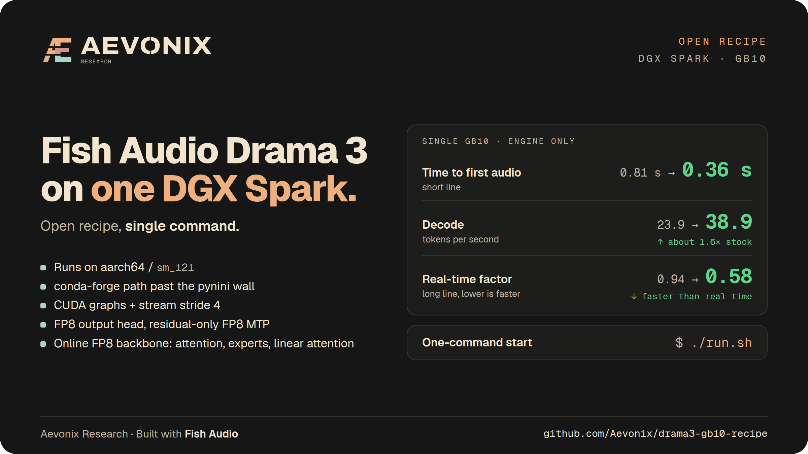

<p align="center">
  
</p>

# Drama 3 on a single GB10 (aarch64, sm_121)

A reproducible path from a clean GB10 box to [Fish Audio Drama 3][drama3] serving
under [SGLang-Omni][sglomni], plus four optional patches that take steady-state
decode from **23.9 to 38.85 tok/s** and long-form RTF from **0.94 to 0.58**, with
engine-side TTFB at **0.36 s**, on one GPU.

```bash
./run.sh
```

That is the whole thing: it creates the conda environment, installs the pinned
serving stack, fetches the weights, applies the patches, writes the measured
configuration and serves, then waits for health. Every step is skipped if it is
already done, so re-running after a failure resumes rather than restarting.
`./run.sh --check` reports what is in place, `./run.sh --stop` stops the service.

The vendor publishes H200 numbers only, and the stack ships an architecture gate
that silently disables two kernel paths on anything that is not sm_90. Everything
below was measured on one GB10 (120 GB unified, aarch64, compute capability 12.1),
single GPU, single stream.

Built with Fish Audio. No weights are redistributed here: this is patches,
configuration and measurements against a pinned upstream revision.

[drama3]: https://huggingface.co/fishaudio/drama-3
[sglomni]: https://github.com/fishaudio/sglang-omni

## Performance

Steady-state decode throughput, median of ~25 decode windows per config, first
window of each burst dropped (it covers a partial post-prefill window and reads
~3.9 tok/s). Engine-side numbers only: TTFB is time to the first audio bytes out
of the HTTP response, RTF is wall-clock / audio seconds.

| config | decode tok/s | vs prev | x noise | short RTF | long RTF |
|---|---|---|---|---|---|
| stock, bf16 | 23.90 | - | - | 0.991 | 0.938 |
| + FP8 output head | 25.71 | +7.57% | 3.8x | 0.944 | 0.875 |
| + fused MTP tower | 26.60 | +3.46% | 1.7x | 0.918 | 0.846 |
| + Triton codebook sampling | 27.17 | +2.14% | 1.1x | 0.881 | 0.833 |
| FP8 head + **full** MTP FP8 (no fusion) | 29.74 | - | - | 0.803 | 0.758 |
| FP8 head + **residual-only** MTP FP8 | **28.2** | +18% | - | 0.851 | 0.789 |

The shipped row is the median of four same-config runs (28.55 / 28.44 / 28.06 /
27.83); every other row is one run. +18% is against the 23.90 baseline.

### Backbone FP8, the largest single step

Measured in a **later series** on the same hardware, so it is kept in its own
table rather than appended as another row above. That series re-measured its own
baseline, the residual-only config, at 28.58 tok/s, which agrees with the 28.2
above inside the 2% noise floor. The percentages below are within the later
series; do not compute a percentage across the two tables.

| config | decode tok/s | vs 28.58 | short TTFB | long TTFB | short RTF | long RTF |
|---|---|---|---|---|---|---|
| baseline (residual-only MTP FP8) | 28.58 | - | 0.420 s | 0.436 s | 0.861 | 0.787 |
| + backbone FP8: attention, shared experts | 30.67 | +7.3% | 0.413 s | 0.422 s | 0.790 | 0.736 |
| + backbone FP8: **and linear attention** | **38.85** | **+36%** | **0.363 s** | **0.372 s** | **0.626** | **0.582** |

The shipped row is `DRAMA3_BACKBONE=1` with the default scope, and is the median
of 28 decode windows, spread 37.92-39.84.

**Memory moves in two directions, and the direction that matters depends on your
box.** Steady state gets slightly *better*, because the converted weights are
smaller: the resident footprint drops from 52.50 to 51.48 GiB. The load-time
*peak* gets worse, 54.13 to 59.91 GiB, because the conversion happens after the
bf16 weights are already resident. On a dedicated box the peak is free and this
is 36% more throughput for nothing. On a box where something else is resident, the
transient is what will kill you, not the steady state. `DRAMA3_BACKBONE=0` turns
it off and returns you to the 28.58 row.

**Why the win is this large.** The routed experts ship already block-FP8, so most
of the weight mass is FP8 before any of this; what remains in bf16 is the
backbone. Decode here is memory-bandwidth bound, so throughput tracks bytes read
per token closely enough that a per-token byte budget predicts it. That budget
predicted 37.3 tok/s for the shipped row and the measurement was 38.85, so the
budget **under**-predicted by 4.1% rather than matching. The honest reading is
that for the linear-attention blocks it is a lower bound, not an equality,
because converting them removes arithmetic as well as bytes.

**Check the conversion summary before you believe a number.** The scope selects
*runtime module* names, which are not the checkpoint tensor names wherever
upstream fuses projections. A scope written from checkpoint names selects nothing,
serves perfectly, and looks exactly like a result:

```bash
grep 'backbone FP8' ~/drama3/serve.log
# ... converted layers per scope={'attention': 20, 'shared_experts': 80, 'linear_attn': 60}
```

If a count is 0, the scope name is wrong, not the model.

**The noise floor is 2%.** A baseline re-check with all patches installed and
every flag OFF gave 23.45 tok/s [23.04-24.08] against the first baseline's 23.90
[23.19-24.37]: overlapping, and the flag-off code path is AST-identical, so the
patches are inert when off. Four same-config runs of the residual-only row gave
28.55 / 27.83 / 28.44 / 28.06, a 2.6% spread, median 28.2. Do not read any single-digit-percent
delta here as real unless it is stated as a multiple of that.

The last two rows are alternatives, not a further step: full MTP FP8 is faster,
residual-only quantizes less. They are a choice, not a ladder. See
[Scope knobs](#scope-knobs).

Configuration alone, before any patch, is the larger TTFB win:

| | short TTFB | short RTF | long TTFB | long RTF |
|---|---|---|---|---|
| defaults (stream_stride 10, CUDA graphs off) | 0.806 s | 1.090 | 0.751 s | 1.000 |
| stride 4 + graph flags | **0.467 s** | 1.086 | **0.473 s** | 1.007 |

-42% / -37% TTFB for four config lines and no code change. With the patches on
top, the residual-only config measures 0.46 s short / 0.52 s long TTFB.

## Requirements

- One GB10 / Grace-Blackwell box, aarch64, CUDA 13, driver with sm_121 support.
- ~75 GB RAM for the serving process. Measured resident peak 58.4 GiB.
- ~42 GB of disk for the weights: Drama 3 is **41.50 GB in 18 files**
  (8 safetensors shards plus a 1.87 GB codec), not the ~36 GB the model card
  implies.
- Network access during install (conda-forge). The weights can be staged offline.

Pinned upstream revisions, all measurements taken against these:

| component | revision |
|---|---|
| sglang-omni | `2cfb3b67becb437b70751defe37e63d3af4eedb0` (2026-10-13) |
| sglang_omni | 0.1.8 |
| sglang | 0.5.21 |
| fishaudio/drama-3 | `dd64a85cd82e9521f7202610ede97b367fc83946` |

## Quick start

### 1. The dependency wall, and the route through it

`sglang-omni 0.1.8` pulls `nemo-text-processing 1.2.0`, which pulls
`pynini 2.1.6.post1`. **pynini publishes no aarch64 wheel**, so pip is forced to
build from source and fails on a missing `Python.h`. Installing `python3-dev`
does not finish the job either: Debian/Ubuntu ship OpenFst 1.7.9 and this pynini
wants the 1.8 era.

conda-forge is the route that works, and is what pynini's own documentation
points at, because it brings OpenFst with it:

```bash
# miniforge, aarch64
curl -LO https://github.com/conda-forge/miniforge/releases/latest/download/Miniforge3-Linux-aarch64.sh
bash Miniforge3-Linux-aarch64.sh -b -p "$HOME/drama3-stage/conda-env"
source "$HOME/drama3-stage/conda-env/bin/activate"

conda install -y -c conda-forge python=3.12 pynini=2.1.6.post1   # brings openfst
```

26 linux-aarch64 pynini builds are published there, including exactly
`2.1.6.post1`. Then install the engine into that same environment:

```bash
git clone https://github.com/fishaudio/sglang-omni
git -C sglang-omni checkout 2cfb3b67becb437b70751defe37e63d3af4eedb0
pip install --prerelease=allow -e "./sglang-omni[fishaudio]"
```

The residual risk is mixing conda-forge binaries into a pip/uv environment; it
held for us, but keep the environment dedicated to this service.

Dropping `nemo-text-processing` instead would mean patching the vendor's serving
stack to remove a declared dependency. Not attempted.

### 2. Configuration that matters

Four settings, measured, worth more than any patch for TTFB:

```yaml
tts_engine:
  engine:
    disable_cuda_graph: false        # decode + prefill graphs
  factory:
    first_frame_cuda_graphs: true    # the first vocoder frame
vocoder:
  factory:
    window_cuda_graphs: true
    stream_stride: 4                 # the knee
```

`stream_stride` is the number of codec frames the vocoder accumulates before it
emits. **4 is the knee, verified in both directions:** 10 -> 6 -> 4 buys
0.806 -> 0.559 -> 0.467 s short TTFB at flat RTF, while 2 buys only 65 ms more
TTFB and degrades short RTF from 1.086 to 1.277.

At stride 4 the vocoder's **first emission is 185.8 ms of audio** and the next
arrives about 360 ms later. If you put any buffering stage downstream of the
engine, keep its window below that first emission or you pay a full extra
emission of latency. Measure the emission size with small reads (2048 bytes) and
group them by inter-arrival gap; a 64 KB read buffer hides it completely.

### 3. Patches

All four are **default OFF** and gated on environment variables, so an
installed patch set changes nothing until you ask for it.

```bash
cd "$(python -c 'import sglang_omni,os;print(os.path.dirname(os.path.dirname(sglang_omni.__file__)))')"
patch --fuzz=0 -p1 < /path/to/patches/0001-sm121-kernel-gate-opt-in.patch
patch --fuzz=0 -p1 < /path/to/patches/0002-output-head-online-fp8.patch
patch --fuzz=0 -p1 < /path/to/patches/0004-backbone-online-fp8.patch
cp /path/to/patches/0003-mtp_fp8.py.new sglang_omni/models/fishaudio_drama3/mtp_fp8.py
patch --fuzz=0 -p1 < /path/to/patches/0003-audio-decoder-mtp-online-fp8.patch
```

Order matters for one pair: **0004 builds on 0002** (both touch
`quantization.py`), so apply 0002 first. The numbering is historical, not an
ordering.

`scripts/apply-patches.sh` does the same with a backup of each file first. Each
patch reverses cleanly with `patch --fuzz=0 -R -p1`.

### 4. The configuration we recommend

```bash
DRAMA3_LM_HEAD_FP8=1 \
DRAMA3_MTP_FP8=1 \
DRAMA3_MTP_FP8_HEADS=0 \
DRAMA3_MTP_FP8_GROUPS=residual_layers \
DRAMA3_BACKBONE_FP8=1 \
DRAMA3_BACKBONE_FP8_SCOPE=attention,shared_experts,linear_attn \
  sgl-omni serve --config your-config.yaml
```

38.85 tok/s, long RTF 0.582, short engine TTFB 0.36 s. Flags are read when the
quantization config is constructed, so they must be in the **launch** environment
of the model worker, not exported later.

Drop the two `DRAMA3_BACKBONE_FP8` lines to get the previous recommendation back
(28.58 tok/s, long RTF 0.787, TTFB 0.42 s) with a 5.8 GiB lower load-time peak.

For maximum speed at the cost of quantizing every MTP projection, drop
`DRAMA3_MTP_FP8_GROUPS` (29.74 tok/s, long RTF 0.758).

## What the patches change

### 0001 - the sm_121 kernel gate (opt-in, unvalidated by the vendor)

The engine logs this on every start, on any GPU that is not an H200:

```
Drama 3 tower fused layers: off, untested GPU sm_121
```

`sampling_kernels.untested_gpu_reason` compares the device's compute capability
for **exact equality** with `VALIDATED_COMPUTE_CAPABILITY = (9, 0)`. It is a
hand-set validation marker, not a capability test, and it gates two unrelated
things: the fused MTP tower and the Triton codebook sampler. Relaxed, the fused
path passed every shape check on sm_121 unchanged and reported
`on for passes up to 16 rows (mix_eh_proj, norm_qkv_rope_store, gate_o_proj_add,
norm_gate_up_silu)`. Decode is one row per request, so decode uses it.

The patch makes the gate a per-feature opt-in,
`DRAMA3_ALLOW_UNTESTED_GPU=tower|sampling|tower,sampling`, kept per-feature so a
numerical change is attributable to one kernel family. **The vendor has not
validated these kernels on this architecture and neither has anyone else; that is
exactly what the gate says.** What we can state: the fused tower ran, the shape
checks passed, and the sampler change is the one we recommend leaving off (below).

If you port anything to a new architecture, grep it for hardcoded capability
tuples first. Check thresholds, not names.

### 0002 - online FP8 for the text output head

`lm_head` is 252288 x 2048 = **0.962 GiB in bf16**, which is 14.6% of everything
read per decoded token. Quantizing it to FP8 at load time, with no checkpoint
conversion, predicted +7.3% and measured **+7.57%**.

The one thing to know: `ParallelLMHead` is **not** a `LinearBase`, so the stock
`Fp8Config.get_quant_method` would never select it. The patch adds an explicit
branch ahead of the generic one. Routed experts are untouched and keep their
serialized block-FP8 config.

### 0003 - online FP8 for the audio-decoder (MTP) projections

The 13 MTP layers are the second-largest byte item, **2.121 GiB per token**.
They are plain `nn.Linear`, so they carry no `quant_method` and the loader's
`process_weights_after_loading` never reaches them. The patch converts them
**after** the decoder's own weight loader has run, which is mandatory: that
loader copies in place into pre-existing bf16 parameters and shards gate/up into
the two halves of `gate_up_proj`.

Per-output-channel scales (safer than per-tensor), dynamic per-token
activations, `per_token_group_quant_fp8` + `apply_fp8_linear`. Every target is
validated before any module is replaced, so a rejected configuration fails the
load instead of leaving a half-converted tower. No `quant_method` is attached, so
the outer postprocess walk cannot double-process it, and the `[out, in]` layout
is kept so the tower's own geometry inspection still works.

Full conversion is 65 projections = 13 layers x (`eh_proj`, `self_attn.qkv_proj`,
`self_attn.o_proj`, `mlp.gate_up_proj`, `mlp.down_proj`).

**FP8 GEMM is CUDA-graph-capturable on GB10** - prefill, decode and first-frame
graphs all captured. That was the largest predicted risk going in.

#### Scope knobs

| variable | default | effect |
|---|---|---|
| `DRAMA3_LM_HEAD_FP8` | off | FP8 output head |
| `DRAMA3_MTP_FP8` | off | FP8 MTP projections |
| `DRAMA3_MTP_FP8_HEADS` | `1` | include the 9 codebook heads |
| `DRAMA3_MTP_FP8_GROUPS` | both | `shared_layers`, `residual_layers` |
| `DRAMA3_MTP_FP8_PROJ` | all five | which projections |
| `DRAMA3_MTP_FP8_SKIP_LAST` | `0` | keep the last N residual layers bf16 |
| `DRAMA3_ALLOW_UNTESTED_GPU` | off | `tower`, `sampling` |

Measured partial-scope rungs, for trading speed against how much of the tower
gets quantized:

| scope | tok/s | long RTF | GiB/token converted |
|---|---|---|---|
| MLP projections only | 27.79 | 0.812 | 0.914 |
| residual layers only | 28.2 | 0.789 | 1.231 |
| all but the last 3 residual layers | 28.42 | 0.793 | 1.368 |
| everything (65 projections) | 29.74 | 0.758 | 2.121 |

The middle three are **all within the 2.6% noise width of each other**, so on
this instrument they are one point, and the one that quantizes least wins on
every other axis.

**Leave the codebook heads off.** They buy +1.1%, which is below the noise floor,
with overlapping spreads (29.36-31.27 vs 28.93-30.89), so they cannot even be
claimed faster. They are nine 4096-way weights feeding the sampler directly,
where a small logit shift changes top-k membership and every later codebook in a
frame is conditioned on the earlier sample. Worst risk in the set for an
unmeasurable gain.

## The byte model

Decode on this model is bandwidth-bound, and a per-token read budget predicts
speedups well enough to rank levers before building any of them:

```
tok/s_new = tok/s_old * bytes_old / bytes_new
```

Per-token read budget, from the safetensors headers (embeddings are row lookups,
not full reads):

| block | GiB/token | share |
|---|---|---|
| backbone dense + attention | 2.666 | 43% |
| audio decoder (MTP) | 2.121 | 34% |
| routed experts, 8 of 256 active | 0.938 | 15% |
| output head | 0.962 | 14% |
| **total** | **6.687** | |

Forecast record, written before each measurement:

| lever | predicted | measured |
|---|---|---|
| FP8 output head | +7.75% | +7.57% |
| fused MTP tower | ~0 | +3.46% |
| full MTP FP8 | 30.0 tok/s | 29.74 |
| MLP-only MTP FP8 | 27.75 | 27.79 |
| residual-only MTP FP8 | 28.54 | 28.55 (first run) |
| all but last 3 residual | 28.89 | 28.42 |

Five correct, one 1.6% high. The fused-tower row is the instructive one: fusion
removes kernel launches and intermediate traffic but **reads every weight in
bf16, so it moves no bytes**, and the model's "about nothing" was nearly right.
SM utilization during decode is 95-96% sustained, so there was little launch gap
to recover in the first place.

## Checks

- `scripts/bench.py` - TTFB, RTF and steady-state decode tok/s from the engine
  log. Point it at your endpoint and log with `DRAMA3_URL` and `DRAMA3_LOG`.
- `scripts/apply-patches.sh` - apply with per-file backups.
- Every patch reverses with `patch --fuzz=0 -R -p1`; the FP8 paths are also
  reversible by unsetting their flag and reloading, since nothing on disk changes.

**There is no cheap numeric quality instrument for this engine, and you should
not build your confidence on one.** Specifically:

- The serving API rejects `seed`. `top_k=1` reaches both samplers, yet greedy
  renders still diverge run to run - non-deterministic reductions flip near-ties -
  and the one genuinely deterministic mode makes the fused path refuse to run.
- ASR word error rate is a gross-breakage tripwire, nothing more. The
  **unmodified** baseline produced a nonzero WER on one emotion line by itself, so
  a nonzero WER after a change proves nothing. Duration envelopes wobble the same
  way: the same short line rendered 1.49-5.11 s across runs at `top_k=1`.
- Weight-memory logs cannot see an FP8 saving. `Load weight end ... mem usage`
  moved the **wrong** way, 37.66 -> 37.80 GB, while the head genuinely was FP8:
  it is an allocator high-water mark, and the transient bf16 copy stays in the
  allocator cache. A later identical load reported 37.17 GB. **Judge FP8 by
  speed.**
- `Detected fp8 checkpoint.` in the log proves nothing about these patches. It
  fires for the experts' already-serialized config.
- Before trusting any head-quantization measurement, check the dispatch gate.
  `logits_processor.should_apply_lm_head_quant_method` decides by
  `type(quant_method).__name__` against a denylist. A method excluded there would
  leave the head quantized in memory while the matmul silently took the
  float-cast branch: no speedup, and indistinguishable from "the byte model is
  wrong".
- `nvidia-smi`'s `mem` column reads 0 and `memory.used` is N/A on GB10, so there
  is no achieved-bandwidth measurement available that way.

Use ears for quality. We do.

## What didn't work

Kept because a recipe is mostly this.

- **The fused tower and MTP FP8 are mutually exclusive.** The fusion gate
  requires, per projection, `type(linear) is nn.Linear` - an exact type check, so
  any quantizable layer class disables it - and `weight.dtype == torch.bfloat16`,
  so FP8 weights disable it too. Either route to FP8 turns fusion off. It fails
  safe: the gate returns a reason and falls back to the plain path, so there is
  no half-fused state. We proved this rather than assuming it, by leaving the GPU
  gate open so the refusal named the type check
  (`tower layer 0 eh_proj is not a bias-free torch Linear`) instead of
  short-circuiting on sm_121. **If you enable MTP FP8, the fused tower switches
  off; do not later read its absence as a regression.**
- **Triton codebook sampling: measurable, and we still recommend against it.**
  +2.14% is about one noise width, and it is the only change that alters the
  sampler itself, which is where voice character comes from. Largest quality risk
  in the stack for the smallest and least certain win, on kernels unvalidated on
  this architecture, with no instrument able to detect a subtle regression. Rank
  levers by risk per point, not by points.
- **NVFP4 on the experts is a build, not a flag.** `quantization.py` hard-fails
  unless the checkpoint declares `quant_method == "bsgemm-moe"`, and `nvfp4`
  appears nowhere in `sglang_omni`, though sglang core has `modelopt_fp4`,
  `nvfp4_online`, `petit_nvfp4` and `mxfp4`. It would need a requantized
  checkpoint, a new FusedMoE quant class and that guard changed. The experts are
  already FP8 on disk and the bf16 originals are not published, so any conversion
  is FP8 -> FP4 and compounds error on the weights you judge by ear. Not
  attempted, and we would not.
- **Splitting the vocoder onto a second machine: not possible with this
  launcher.** Stage placement is expressed as `gpu`, `tp_size` and `process`, and
  the GPU IDs are explicitly indices into the local host's visible devices. The
  serving path spawns every stage locally over IPC sockets. Mooncake transport
  primitives exist in the tree but nothing in the serving path uses them to place
  a stage on another host. This is also why the recipe is single-GPU: one GB10 is
  one device, so TP > 1 has nothing to shard across.
- **Chasing the decode CUDA graph is not worth it.** The decode graph is captured
  (bs=[1]) and then never used; the per-batch `cuda graph: False` field is not
  noise, it prints `can_run_cuda_graph`. Which of
  `decode_cuda_graph_runner.can_run_graph`'s conditions fails is not findable by
  source reading (`replace_embeds` is not it - Drama 3 passes `input_embeds`). We
  recommended chasing this first and had to reverse that: decode is already
  95-96% SM busy, so graph replay would buy little even if recovered.
- **Raising `max_running_requests` does not create concurrency.**
  `preprocessing.factory.max_concurrency: 1`,
  `vocoder.factory.max_batch_size: 1` and `disable_overlap_schedule: True` each
  serialize independently. A per-request flag cannot isolate a confound that is
  established at init.
- **`stream_stride: 2`** - 65 ms of TTFB for short-form RTF 1.086 -> 1.277.
- **`max_new_tokens` is hard-capped at 256** and over it the request 400s with
  `max_new_tokens must be at most 256; got N`. Read the error body: every failure
  looks like a reference problem until you do. The cap does **not** truncate -
  256 produced a complete 10.6 s line, transcribed word for word.

## Repository layout

```
run.sh     one command: set up what is missing, then serve
patches/   the three patches, default OFF, each reversible
scripts/   apply-patches.sh, bench.py
assets/    the card at the top of this file, and its HTML source
README.md  this
CHANGELOG.md  CREDITS.md  LICENSE  NOTICE
```

## License

The patches and scripts here are Apache-2.0, matching upstream SGLang-Omni. See
`LICENSE`.

Drama 3 itself is **not** covered by that. It ships under the Fish Audio
Community License and nothing in this repository grants you anything in respect
of the model. Read `NOTICE` before you use it for anything beyond personal
evaluation, and read the license yourself rather than our summary of it.

## Credits

See `CREDITS.md`.
